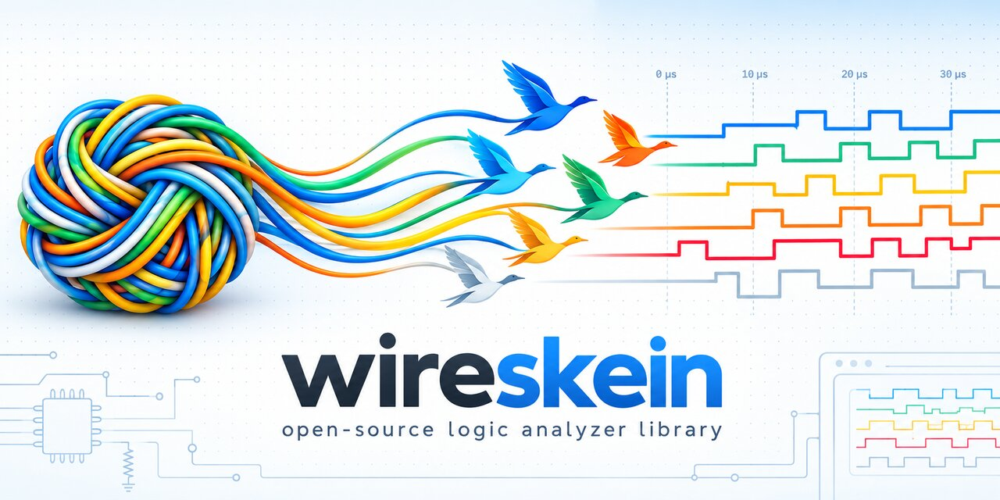

# WireSkein



[日本語 README](https://github.com/Open-Embedded-Probe/wireskein/blob/main/README.ja.md)

WireSkein turns logic-analyzer captures into **tests and analysis** (MIT license). Instead of ending with someone looking at a waveform, it checks in code whether the wire did what it should, and hands what was on the wire to scripts and AI in a form they can read.

- **Checking recorded hardware test runs.** A test records what it sent, the captures, and what each step should look like on the wire (a 1 kHz square wave, an I2C write to 0x42, a UART at F_CPU / BRR, a 3.3 V ± 0.1 V supply). `wireskein verify` checks every capture against these expectations and reports OK / NG with measured values, as text, JSON and JUnit XML. From pytest, use [pytest-embedded-wireskein](https://github.com/Open-Embedded-Probe/pytest-embedded-wireskein).
- **Decoding unknown captures.** `wireskein analyze` finds which pins carry I2C, SPI, UART, RVSWD / SWIO, SWD, CAN, RGB LED (WS2812), 1-Wire or IR (NEC, experimental), and decodes them. Upper layers (NMEA, Modbus, known I2C / SPI devices, SD cards in SPI mode) are tried on top.
- **Capturing, storing, viewing.** `wireskein capture` takes captures from a probe, stores them as `.wireskein`, and `wireskein gui` shows them in the browser.

Status: **beta**. Until version 1, breaking changes happen; see [Stability](#stability).

## Why WireSkein

A logic analyzer is essential in embedded work, but the usual tools are built around a person looking at a screen. That leaves these problems:

| The problem | How WireSkein solves it |
| --- | --- |
| **Captures are not tests.** You look at the waveform and decide it is probably right. There is no way to check a capture against expectations, get OK / NG, and run it in CI | The test states its expectations in code (`square`, `uart`, `i2c`, `voltage`, ...) and `wireskein verify` checks them with measured values. JUnit XML and a pytest plugin put it straight into CI |
| **Tied to the hardware.** The easiest apps expect their own analyzers; cheap analyzers and home-made probes do not fit, and licenses may not allow embedding or changes | Any source: sigrok `.sr` and VCD files are read as they are; capture directly from sigrok devices or from OEP probes built on boards such as the ESP32. MIT license |
| **Decimated or slow channels are padded with fake samples.** Existing formats have one rate for all channels, so a channel kept at a lower rate is filled with samples that were never taken | A `.wireskein` keeps each channel at its own rate and stores only the samples taken; the viewer shows the real samples and how uncertain each edge is |
| **Logic and analog live apart.** Separate recordings, separate tools, times lined up by hand | Logic and analog in one file; `wireskein align` finds the offset and time scale from the edges of a signal seen on both; analog channels take logic checks (`threshold=`) and voltage checks |
| **Too much data.** Having people or AI read every waveform and event is heavy, yet summarizing can drop what matters (a link that speeds up mid-capture can be taken for noise) | Structured output of just the layers needed (a command list, spans, or full detail), without hiding undecoded spans, the evidence for each candidate, or the capture quality |
| **Every use of the output needs glue code.** Re-parsing display strings, one conversion script per tool | Output is JSON with a stable structure; times are integer ticks that lead back to the capture |

### AI-friendly

- **CLI and JSON first.** Everything works without a screen: an AI agent can run a command, read the result and decide the next step.
- **Just what is needed.** `analyze --select` (layers), `--window` (time range) and `--segment` (a marker span) pass only the part a question needs, saving tokens.
- **The grounds for each answer.** Decoding candidates, how well they fit, where they do not, and undecoded spans come back, so an AI can tell what was read from what was not.
- **Checks come with measurements.** An NG gives its reason and the measured values (frequency, duty, baud error, voltage, ...), which points toward the cause.
- **Findings stay with the capture.** Notes, attachments, markers and decoding annotations go into the same file, so the next person, or the next AI, sees how it was investigated.

### Test-friendly

- **Expectations are code.** `wireskein.runlog` uses only the standard library, so it fits into any test script.
- **The test's structure is recorded.** Headings (`#` a test, `##` a step) build a tree of segments, and each capture belongs to one, so an NG names the step and the expectation.
- **Pins and roles are given.** Checks do not depend on automatic detection, so results are stable. How to choose capture windows and tolerances: [docs/capture-test-guide.md](docs/capture-test-guide.md).
- **Straight into CI.** JUnit XML, and with [pytest-embedded-wireskein](https://github.com/Open-Embedded-Probe/pytest-embedded-wireskein) each pytest test is recorded and checked. The captures of an NG stay as files to open in the viewer later.

### Sources: existing formats, and OEP probes

- **Existing formats work as they are.** sigrok / PulseView `.sr` and VCD (GTKWave, Saleae, DSView, simulators, ...) are recognized by their content, not their names, and can also be written. sigrok devices capture directly with `wireskein capture --source sigrok:<driver>`.
- **[Open Embedded Probe (OEP)](https://github.com/Open-Embedded-Probe/oep-spec)** is an open protocol between a small board wired to the chip you develop on (the probe) and the software on your PC. One probe is a debugger (RVSWD / SWIO for WCH's CH32, SWD for ARM), a console to the target and a test fixture (GPIO, UART, SPI / I2C devices, logic and analog capture) at once. Firmware: [oep-probe-arduino](https://github.com/Open-Embedded-Probe/oep-probe-arduino); host side: [oep-client-python](https://github.com/Open-Embedded-Probe/oep-client-python).
  - With an **ESP32-P4** as the probe, logic capture runs **from 16 channels at 20 Msps up to 160 Msps on 2 channels** (40 Msps on 8). Each test picks the pins it captures, with no change to wiring or firmware.
  - A classic ESP32 and other boards work too, more slowly: a probe declares what it can do, and WireSkein uses that. With ADC channels, analog is captured alongside.

## Install

```sh
pip install wireskein              # or: uv add wireskein
```

Python 3.11 or newer. The only dependency is numpy.

## Checking a test run

A test records a run with `wireskein.runlog`. This module uses only the standard library.

```python
from wireskein.runlog import Recorder, square, level, only_moving

rec = Recorder("out/run1", target="x035")
with rec.section(1, "test_pwm"):
    for duty in (64, 128, 0):
        want = [square("PA1", 1000, duty / 255), only_moving(["PA1"])] if duty else [level("PA1", 0)]
        with rec.section(2, f"duty={duty}", expect=want):
            rec.command(f"PWM {duty}")          # what the host sent
            rec.reply(reply_line)               # what the device answered
            t = rec.armed()                     # time.monotonic_ns() right after arming the capture
            data = read_capture()               # the probe's samples: one byte per sample, bit k = pin k
            rec.capture(t, rate, interleaved=data, names=["PA1", "PA0"], start_ns=seg.start_ns, start_uncertainty_ns=seg.start_uncertainty_ns)
rec.close()
```

Then check it:

```sh
wireskein verify out/run1 --junit out/run1/report.xml --json out/run1/report.json
```

```text
OK  test_pwm/duty=64  square  c0001.wireskein
OK  test_pwm/duty=64  only_moving  c0001.wireskein
NG  test_pwm/duty=128  square  c0002.wireskein  duty 0.6999 vs 0.5020
OK  test_pwm/duty=128  only_moving  c0002.wireskein
OK  test_pwm/duty=0  level  c0003.wireskein
4 ok, 1 ng, 0 unchecked, 0 measured (4 segments, 3 captures)
```

The captures are stored as `.wireskein` files (below). The exit code is 1 when a check fails. A check that could not be made (its pins are not in the capture, ...) is **unchecked** (`--`) and **fails the run by default**, since it is usually a mistake in the test or the wiring (`--allow-unchecked` lets it pass). A check asked only to measure (`uart(baud=None)`, ...) is **measured** (`ME`) and does not fail. The run format and the result statuses: [docs/run-format.md](docs/run-format.md).

### Headings and segments

Headings split the run into a tree of segments. `#` is a test, `##` is a step, and a heading without a name (`##`) closes that level. `Recorder.section()` opens a heading and closes it when the `with` block ends. A capture belongs to the segment that was open when it was recorded (its path is stored with it). Expectations are stored under the segment path, for example `test_pwm/duty=64`. When a name repeats under the same parent, the first keeps its name and the repeats get an index (`duty=64`, `duty=64[1]`, `duty=64[2]`), each with its own expectations; adding a repeat later does not rename the earlier ones. A broken structure, such as a skipped level, is always reported as NG.

### Checks

| Helper | Checks |
| --- | --- |
| `square(pin, freq_hz, duty, freq_rel, duty_abs, jitter_max, outliers_max)` | A steady square wave, every period: frequency (relative tolerance), duty (absolute), period spread |
| `becomes(pin, level=v)` / `becomes(pin, freq_hz=, duty=, ...)` | The pin ends the segment in a level or a wave, reached by one change from the state before it (at most `irregular_max` odd pulses at the change); the change's time is measured |
| `trim(check, head_s, tail_s, head_periods=, tail_periods=)` | Any check without the ends of its segment |
| `level(pin, value)` | The pin does not move |
| `starts({pin: v})` / `ends({pin: v})` | The level at the first / last sample |
| `only_moving([pins])` | No other captured pin moves |
| `pulses(pin, count, period_s, period_rel)` | Number of rising edges and their period (`period_rel` relative) |
| `i2c(scl, sda, transactions, freq_hz, freq_rel, released)` | Transactions (address, direction, bytes, the ACK after the address and after each byte, `complete`), SCL rate, and a released bus at the end |
| `spi(clk, mosi, miso, cs, mode, mosi_bytes, miso_bytes, freq_hz)` | Mode, bytes on both lines, SCK rate, and CS high at the end |
| `uart(pin, baud, data, baud_rel, idle, bits, parity, stop, errors)` | Bit rate measured from the edges, data, idle level, and framing / parity errors. `baud=None` only measures |
| `voltage(pin, level_v, level_abs_v, level_min_v, level_max_v, ripple_max_v)` | An analog channel: mean within `level_v` ± `level_abs_v`, every sample within `level_min_v`..`level_max_v`, peak-to-peak at most `ripple_max_v`. Only what is given is checked |

The logic checks (`square`, `level`, `starts` / `ends`, `pulses`, `i2c`, `spi`, `uart`) also run on analog channels when given `threshold=`: one voltage, or `(low, high)` for hysteresis (a noisy slow edge then makes one edge). Edges are placed where the line between two samples crosses the threshold; the resolution is one ADC sample, added to the tolerances. Without `threshold=`, an analog channel in a logic check is unchecked, and the reason says so.

Pins and roles are given, so these checks are verification, not discovery. How to choose capture windows and tolerances, with examples from real runs, is in [docs/capture-test-guide.md](docs/capture-test-guide.md) (with every check, not only these).

If a capture has the meta `time_base_slipped: true` (the probe knows some samples were taken late), the verdict does not change, but a failure's reason says so.

### Python API

```python
from wireskein.verify import verify, junit, dumps, lines, summary_line

report = verify("out/run1")          # dict: results (with measured values), summary, log
xml = junit(report)                  # JUnit XML
text = dumps(report)                 # JSON
print(*lines(report, ok=True), summary_line(report), sep="\n")   # as the CLI prints them (without ok=True: the lines that are not OK)
```

For pytest, [pytest-embedded-wireskein](https://github.com/Open-Embedded-Probe/pytest-embedded-wireskein) gives each test a `ws_run` recorder and runs `verify` after the test.

## Capturing

`wireskein capture` takes logic channels from a device and saves a `.wireskein`:

```sh
pip install "wireskein[oep]"      # for OEP probes (oep-client-python); sigrok needs sigrok-cli on PATH
wireskein capture --source oep:oep://30eda0ea068b --channels SDA=GPIO47,SCL=x035.scl --rate 20M --samples 200k -o i2c.wireskein
wireskein capture --source sigrok:fx2lafw --channels SDA=D0,SCL=D1 --rate 12M --samples 1M \
                  --trigger SCL:fall --pretrigger 1k --note "after reflow" -o i2c.wireskein
```

| Source | Device | Channels |
| --- | --- | --- |
| `oep:<address>` | An OEP probe through oep-client-python (its `acquire`). `<address>` is its OEP address, `oep://<unit_id>` with an optional route (`?via=usb`, `cdc`, `net`, `tcp:HOST:PORT`, `tty:PATH`), or a short form: a serial port, `tcp://HOST:PORT` | The probe's channel names (`GPIO47`) or its ports' line labels (`x035.scl`); a number holds for one boot only |
| `sigrok:<driver>` | Any device sigrok supports, through `sigrok-cli` (`fx2lafw`, `dreamsourcelab-dslogic`, `demo`, ...) | sigrok's channel names (`D0`, ...) |

`--channels` names each logic channel (`NAME=ID`). On an OEP probe with capture format 1, a line that needs less than every sample can be reduced over intervals of D samples, written after the id as `MODE:D`: `CLK=6/sample:4` every 4th sample (`bits` with step 4 in the file), `CS=5/any_low:8` 0 for each 8 samples that held a 0 (`any_low`; `any_high` the other way), `EN=7/change_latch:64` per 64 samples its last level and whether it changed (`change_latch`) ([file format](docs/wireskein-format.md) §4.5). The checks answer only what a reduction makes sure (a count of pulses as a lower bound, a level read at the reduced level unchecked). `capture` prints the bytes the probe sent against what the setting makes of them (`data:`, kept in `meta.probe.data`), and a stream's bytes a second (`data rate:`, `meta.probe.data_rate`). `--mode stream --duration 2s` streams logic channels for longer than the probe's memory; if the probe drops data, `--on-loss stop` (the default) stops there and `--on-loss continue` goes on, and either way what was taken is kept but the capture fails (`INCOMPLETE`, exit 1; the file says `complete: false`). With `--analog`, a stream takes the analog channels too (both tracks started in one group; analog alone works too), each part holding the analog samples of its time. `--mode repeat --segments 20` takes 20 acquisitions of `--samples` into one file (OEP repeat), each read and released as it finishes, so more than the probe holds; with `--trigger` each starts on its own trigger (rearm) and the file is `layout: segments`, each part its own trigger and time (the viewer switches them as tabs); without, they run on as a timeline. `--analog NAME=ID[@FRONTEND],...` adds analog channels (`--analog-rate`, `--analog-samples`; by default as long as the logic capture). On an OEP probe, logic and analog are started together (capture-group); each analog channel keeps its own rate and start (the probe's estimate, with its uncertainty), raw values, input range, reference and the probe's factory calibration. With `--trigger` every track is cut on the one event (OEP capture §4.4's trigger source), each keeping its own pretrigger. An analog line can be the trigger too: `--trigger VDD:fall:2.9` (crossing down through 2.9 V) or `VDD:low:2.9` (staying below it); the event's time and uncertainty go to `meta.probe`. With sigrok, analog ids ride at the device's one rate.

The file keeps the rate the device actually used, plus what the source knows: the probe's `start_ns` and `start_uncertainty_ns` (the probe clock of the first sample), a `time_base_slipped` mark (the probe knows some samples were taken late, e.g. at its buffer limit, so times may be stretched there; `wireskein info` says so, and a failed check names it), the trigger position in ticks (`trigger_tick`). On a UART probe (a classic ESP32 jig, say), the link is raised to a faster rate for reading the capture back: rates that hold are tried and chosen, and remembered per port and probe (an oep-client-python feature). `--fast 0` keeps the boot speed, `--fast 921600` (or a list) tries only those. A probe with USB (an ESP32-P4) is best opened over USB, `oep:oep://<unit_id>` or `?via=usb`: the vendor bulk interface reads back at megabytes per second without loss, where its USB serial port (CDC) is slower and can drop answers under load. `capture` prints how the link went (the rate, the trials, the read time), also kept in `meta.probe.link`. From Python: `wireskein.sources.capture(source, Request(...), out)`. Other packages can add sources through the `wireskein.sources` entry point group, checks through `wireskein.checks` ([docs/capture-test-guide.md](docs/capture-test-guide.md) §4.10), and protocols that ride on UART, SPI or I2C through `wireskein.protocols` ([docs/protocols.md](docs/protocols.md)); [docs/extending.md](docs/extending.md) says which way fits what.

## Viewing captures in the browser

```sh
wireskein gui capture.wireskein    # opens the browser on that capture (a .sr or .vcd is converted on the fly)
wireskein gui runs/                # a page listing the captures and recorded runs below runs/
```

The viewer is [wireskein-web](https://github.com/Open-Embedded-Probe/wireskein-web), shipped in the wheel (also on
[GitHub Pages](https://open-embedded-probe.github.io/wireskein-web/) for files opened in the browser). It shows:

- logic and analog lanes on a time axis; hover to measure pulse widths, period, frequency and duty (analog: the value);
  Shift + wheel scrolls in time;
- the samples the probe really took (a decimated channel shows only its own), the trigger, and analog on the aligned
  time when the file has an alignment;
- decoding annotations (I2C transactions, UART characters, ...) under their data line: from the file
  (`wireskein annotate --save`), or decoded on request with a button to store them;
- markers: M puts one at the mouse, and they are saved into the file;
- for a capture of a recorded run, the run's check results (OK / NG and why);
- the metadata, acquisition settings, attachments and notes, with a form that appends a note.

The server listens on 127.0.0.1 only and prints a URL with a one-time token; requests without it, or for another host
name, are refused. For a bench machine, forward the port (`ssh -L PORT:127.0.0.1:PORT bench`) and open the printed URL.
It serves nothing but the viewer and the capture files below the directory given.

## WireSkein files (.wireskein) and conversion

A WireSkein file (`.wireskein`, a zip) holds a capture and what goes with it: attachments, notes, markers and decode annotations. Tools tell it apart by its content, not its name. A capture keeps each channel at its own sample rate. A probe that decimates some channels to fit its link (every 32nd sample, say) stores only the samples it took, with `step=32`. Nothing is repeated to fill the gaps, so a viewer can show exactly the samples that exist. The module `wireskein.capture` reads and writes it with the standard library only (numpy only to turn a line into its changes):

```python
from fractions import Fraction
from wireskein import capture as wc

part = wc.Part(n, [
    wc.Channel("PA5", wc.pack(pa5_samples), n),                 # samples: one byte per sample, 0 or 1
    wc.Channel("PB0", wc.pack(pb0_samples), n // 32, step=32),  # a channel kept at 1/32 of the rate
], {"start_ns": seg.start_ns, "start_uncertainty_ns": seg.start_uncertainty_ns})
wc.write("c.wireskein", wc.Capture(100_000_000, [part]))
channels = wc.from_interleaved(data, ["PA5", "PA7"], width=8)    # a probe's stream: width bits per sample, bit k = channel k

cap = wc.read("c.wireskein")                                     # every part, with what was lost (cap.lost)
initial, edges = cap.parts[0].channel("PA5").changes()           # ticks from the part's tick 0
```

Analog channels can sit in the same file, each with its own rate and start time (`t0_ticks`), so an ADC whose real rate is not a whole number of logic ticks keeps its true timing. ADC values are kept raw with their linear conversion (`zero`, `scale_nv`), and how they were taken (pin, attenuation, reference voltage, the probe's factory calibration values) is stored too, whether or not the analysis uses it:

```python
wc.write("m.wireskein", wc.Capture(20_000_000, [wc.Part(n, [
    wc.Channel("CLK", wc.pack(clk_samples), n),
    wc.analog_raw("VBUS", raw_values, Fraction(80_000_000, 1667), width=16, value_bits=12, zero=0, scale_nv=805_860,
                   pin=22, attenuation_db=12, reference={"source": "vdd", "mv": 3300}),
    wc.analog_volts("SINE", volts, 1_000_000),                     # volts, e.g. from sigrok or Saleae
])], meta={"probe": {"chip": "ESP32-P4", "calibration": {"scheme": "curve-fitting-v1", "raw": "..."}}}))
```

In a recorded run, pass the same channels to `rec.capture(t, tick_hz, channels=[...])`.

`wireskein capture --source sigrok:<driver>` takes analog channels too (`--channels CLK=D0,VBUS=A0`). The analysis reads the logic channels; the checks read analog channels too (`voltage()`, and `threshold=` on the logic checks). The format is specified in `docs/wireskein-format.md`.

A probe's analog start time is an estimate (an ADC may start some hundred microseconds off and run a little fast or slow). When the same signal is on a logic channel and an analog channel (the same net wired to both, or a marker pulse), `wireskein align` finds the offset and the time scale from its edges and stores them as `attach/alignment.json`; the samples and stored times are not changed:

```sh
wireskein align m.wireskein --reference SYNC --via SYNC_A --threshold 1.0,2.3 --save
# SYNC_A against SYNC: start +197.890 us, scale +1490.7 ppm, 166/166 edges matched, residual 5.665 us
```

Other tools read the result from `attach/alignment.json` (wireskein-format §5.1). A periodic signal is ambiguous when the start may be off by more than its period: give `--max-offset`, or align on an irregular marker pulse.

Captures from two probes taken at the same time line up the same way, from a signal both saw (wired to a pin of each):

```sh
wireskein align B.wireskein --to A.wireskein --reference SYNC --via SYNC --save
# B.wireskein onto A.wireskein: tick 0 at +3699.999 us, clock -79.98 +- 0.02 ppm, 264/264 edges matched, residual 0.031 us
```

The result goes into B's `alignment.json` (with A's identity); neither file's samples change. The viewer's "Add another probe's file" then draws B's channels on A's time axis (`align.between()` in Python).

A WireSkein file can also carry anything else about the capture: acquisition settings, a wiring note, analysis results. Attachments are named files (text, JSON or bytes) and can be replaced. Notes form an append-only log, one entry per call, with its time. Both can be added to an existing file without rewriting the channels:

```python
wc.attach("c.wireskein", "probe.json", {"fw": "1.2", "plan": plan})   # dict / list -> JSON, str -> text, bytes as is
wc.note("c.wireskein", "PA5 looked noisy; shorter wire next time")
wc.note("c.wireskein", {"i2c": transactions}, kind="analysis")
wc.attachments("c.wireskein"), wc.notes("c.wireskein")
```

```sh
wireskein info c.wireskein                                  # channels and rates, metadata, attachments, notes
wireskein states c.wireskein --pin PB6                      # each line as levels, waves and the odd pulses between
wireskein note c.wireskein "re-captured after reflow"
wireskein attach c.wireskein setup.txt --text "10k pull-ups on SDA/SCL"
wireskein attach c.wireskein scope.png scope.png            # any file
```

`rec.capture(..., attachments={...})` stores attachments with a capture of a recorded run. Attachments and notes go along when a capture is converted to `.sr` and back.

Convert between formats on the command line (the format follows the extension):

```sh
wireskein convert c0001.wireskein c0001.sr     # for PulseView: one rate, slow channels repeated
wireskein convert c0001.sr c0001.wireskein     # back: channels get their real rate again
wireskein convert c0001.wireskein c0001.vcd    # GTKWave etc.: only the changes, each channel at its own rate
wireskein convert saleae.vcd s.wireskein       # a VCD from elsewhere: the tick is the common divisor of its times
wireskein convert long.sr part.wireskein --from 0.1 --to 0.5   # an excerpt, seconds from the start (meta.excerpt)
```

A `.sr` has one sample rate for all channels, so slow channels are repeated to the fastest rate there. The real rate of each channel is kept in `wireskein.json` inside the `.sr`. sigrok ignores this file, and WireSkein reads it back. In PulseView, the repeated samples look like real ones.

A logic `.sr` is converted a block of samples at a time, straight into the WireSkein file: a capture of any length (a long stream at a high rate, gigabytes) in a block's memory. `--from` / `--to` write only a stretch of it.

## Decoding a capture

```sh
wireskein analyze capture.wireskein          # a WireSkein file, a sigrok .sr or a VCD
wireskein analyze capture.sr --hint '{"protocols": ["i2c"]}'
wireskein analyze m.wireskein --threshold TX=1.0,2.3        # also decode an analog channel, read as logic
wireskein analyze capture.sr --mode all --out result.json
wireskein segments capture.sr --results                   # a capture with marker lines on a UART
```

`--hint` restricts what is tried. It can name protocols, or give pins with their roles and baud rates. The result is still scored by the decoders' own checks.

When the wiring is known (a run that drove a part through its bus), `wireskein decode` gives the buses a spec names, decoded with exactly those roles however little a short case shows, every part of the capture on its own, with what was not read and what was lost beside them ([docs/analysis-format.md](docs/analysis-format.md)):

```sh
wireskein decode c0001.wireskein --spec '{"buses": [{"protocol": "i2c", "pins": {"scl": "SCL", "sda": "SDA"}}]}' --out analysis.json
```

```python
from wireskein.decode import load, save, analyze, export

cap = load("capture.wireskein")                                     # or .sr / .vcd
res = analyze(cap, {"protocols": ["spi"]})
doc = export(res, cap)
```

After each bus, `decode` and `analyze` say how it read on stderr: frames read and ok, unread stretches, the clock's
speeds, and when it did not read well, whether the sample rate is too low for the clock (with the rate to capture at,
the least and the best) or the lines carry noise (glitches, ringing). How to capture so that it reads, and what to
do about each: [docs/capturing.md](docs/capturing.md).

A long capture (gigabytes) is read a block at a time and analysed in pieces, memory bounded whatever its length
([docs/long-captures.md](docs/long-captures.md)):

```sh
wireskein survey long.sr                                   # how each line moves over the whole, read once
wireskein decode long.sr --spec spec.json --split workers=4 --items items.ndjson --out analysis.json
wireskein analyze long.sr --pins SWCLK,SWDIO --split max_edges=500000
```

## Stability

Until version 1, breaking changes are allowed and backward compatibility is not kept.

- Every format is number 1 until version 1 (`wireskein/1`, `wireskein-run/1`, `wireskein-analysis/1` and the parts of a file), also through incompatible changes; from version 1 on an incompatible change raises the number, an addition does not. A reader refuses a number it does not know, with a clear error, and ignores keys it does not know; older numbers are not read.
- Additions (new keys, new arguments) keep the current meaning by default.
- `wireskein._engine` is internal.

## Repository layout

```text
src/wireskein/          the package (capture, runlog, verify, decode, sources, cli, _engine, decl/ data)
tests/                  pytest (tests/data: real captures and examples)
eval/                   measuring what analyze infers: the corpus with ground truth and the scripts (not packaged)
docs/                   specifications and design decisions (English and Japanese)
tools/                  fetching the viewer, release scripts
```

To measure the inference: `uv sync`, then `cd eval && uv run python evaluate.py --set heldout`. See [eval/README.md](eval/README.md).

## Development

```sh
uv run pytest
uv build
```

## Release

Releases use GitHub Actions, the same way as pytest-embedded-arduino-cli.

1. Update the `## Unreleased` section of `CHANGELOG.md`.
2. Run the `Release` workflow manually and enter the version (`X.Y.Z`).
3. The workflow does the rest. It updates the version in `pyproject.toml` and `src/wireskein/__init__.py`, moves the changelog entries under the new version, runs the tests, builds, commits, tags `v<version>`, creates a GitHub Release, and publishes to PyPI.

PyPI publishing uses Trusted Publishing.

## License

MIT
